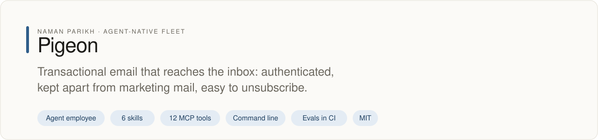
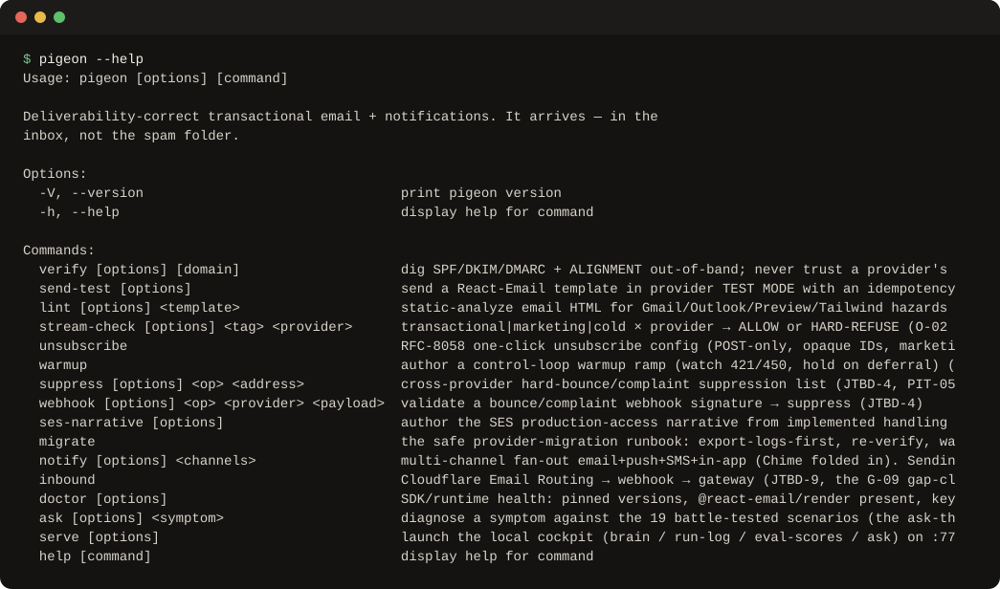

# pigeon

<!-- fleet:header:start -->
<p align="center"><picture><source media="(prefers-color-scheme: dark)" srcset="assets/banner-dark.svg"></picture></p>

<p align="center">
<a href="https://github.com/naman10parikh/pigeon/actions/workflows/ci.yml"></a>
<a href="https://github.com/naman10parikh/pigeon/releases"></a>
<a href="LICENSE"></a>
<a href="#use-it-from-any-coding-agent"></a>
<a href="https://x.com/naman10parikh"></a>
<a href="https://www.linkedin.com/in/naman-parikh1/"></a>
</p>

<p align="center"><a href="#quick-start">Quick start</a> · <a href="https://naman10parikh.github.io/pigeon/">Website</a> · <a href="docs/README.md">How it works</a> · <a href="AGENTS.md">AGENTS.md</a> · <a href="llms.txt">llms.txt</a> · <a href="skills/">Skills</a> · <a href="https://github.com/naman10parikh/pigeon/discussions">Discussions</a> · <a href="https://github.com/naman10parikh">All projects</a></p>

**Transactional email that reaches the inbox: authenticated, kept apart from marketing mail, easy to unsubscribe.**

Pigeon is an agent employee, a packaged specialist agent with its own skills, memory and tests. It owns one job: transactional email. Coding agents use it through its skills, its MCP server and its command line. Its evals gate every merge in CI. A person makes every change.

_Pigeon is part of an agent-native play for agent-native systems that can eventually be recursively self-improving and evolving, operated by agent employees._

<p align="center"></p>
<!-- fleet:header:end -->

## What it is

pigeon makes transactional email arrive in the inbox, not the spam folder. It sits above whichever email
provider SDK is wired (Resend by default; Postmark and SES as alternatives) and owns what the SDK leaves
out: domain authentication and alignment, keeping transactional mail apart from marketing mail, rendering
that works in every client, suppression, warmup, one-click unsubscribe and safe provider migration. It
is for teams and agents that send password resets, receipts and alerts and need them to land.

<!-- fleet:use:start -->
## Use it from any coding agent

**Claude Code**: the plugin brings the skills, sub-agents, hooks and MCP server.

```
/plugin marketplace add naman10parikh/pigeon
/plugin install pigeon@pigeon
```

<details><summary>Its MCP server, Codex, Cursor, Gemini CLI, one skill and the command line</summary>

**Its MCP server**, in any MCP client:

```bash
claude mcp add --transport stdio pigeon -- npx -y -p github:naman10parikh/pigeon pigeon-mcp
codex mcp add pigeon -- npx -y -p github:naman10parikh/pigeon pigeon-mcp
```

Cursor (`.cursor/mcp.json`), Gemini CLI (`.gemini/settings.json`) and most other clients take the same command as JSON:

```json
{
  "mcpServers": {
    "pigeon": {
      "command": "npx",
      "args": [
        "-y",
        "-p",
        "github:naman10parikh/pigeon",
        "pigeon-mcp"
      ]
    }
  }
}
```

**Gemini CLI**: the extension brings the context and the MCP server.

```bash
gemini extensions install https://github.com/naman10parikh/pigeon
```

**One skill** (6 in all, in [skills/](skills/)), in any agent that reads Agent Skills:

```bash
gemini skills install https://github.com/naman10parikh/pigeon --path skills/pigeon-deliverability-audit
git clone --depth 1 https://github.com/naman10parikh/pigeon /tmp/pigeon && cp -r /tmp/pigeon/skills/pigeon-deliverability-audit ~/.claude/skills/
```

**The command line:**

```bash
npx -y -p github:naman10parikh/pigeon pigeon --help
```

</details>

Codex, Cursor, OpenCode, GitHub Copilot and other agents read [AGENTS.md](AGENTS.md); Claude Code reads [CLAUDE.md](CLAUDE.md) and Gemini CLI reads [GEMINI.md](GEMINI.md), which import it. [llms.txt](llms.txt) maps every surface for agents that read first.
<!-- fleet:use:end -->

## Quick start

You need Node.js 18 or later and pnpm.

```bash
git clone https://github.com/naman10parikh/pigeon && cd pigeon
pnpm install && pnpm build

# Check SPF, DKIM, DMARC and alignment (here from a DNS fixture, so it needs no network)
node dist/cli.js verify notifications.example.com --dns-fixture eval/fixtures/dns/aligned.json

# Refuse the routing that gets a whole account suspended (exits 1 with the reason)
node dist/cli.js stream-check cold postmark

# Send in provider test mode with an idempotency key (without RESEND_API_KEY it returns a stub result)
node dist/cli.js send-test --provider resend --test-mode --template welcome --to delivered@resend.dev

# Find rendering hazards in a React Email template
node dist/cli.js lint src/templates/welcome.tsx

# Diagnose a symptom against the 19 battle-tested scenarios
node dist/cli.js ask "password reset emails land in spam"

# Run the tests and the golden evals (12 tasks, F1 floor 0.80)
pnpm test && pnpm eval
```

Without a clone, `npx -y -p github:naman10parikh/pigeon pigeon --help` runs the command line straight
from GitHub.

## How it works

- **Check DNS yourself.** `pigeon verify` reads SPF, DKIM and DMARC with its own lookups and checks
  alignment. It never trusts a provider's "verified" flag and never polls a mutating endpoint.
- **Keep the streams apart.** Every send carries a stream tag: transactional, marketing or cold.
  `pigeon stream-check` refuses to route cold or marketing mail through a transactional-only provider,
  because that gets the whole account suspended, password resets included. A hook enforces the same rule
  before an agent's shell command runs.
- **Send once.** Every send carries an idempotency key derived from its content, so a retry after a
  network error does not send twice.
- **Render correctly.** `pigeon lint` finds the Gmail, Outlook and preview-text hazards that send good
  mail to spam or break it on screen.
- **Handle what comes back.** `pigeon suppress` and `pigeon webhook verify` stop mail to bounced and
  complaining addresses across providers; `pigeon warmup plan` ramps a new domain by watching deferrals.
- **Know the field.** The brain in `brain/` holds 10 jobs, 19 battle-tested scenarios, 26 opinions and 26
  known pitfalls. `pigeon ask "<symptom>"` matches a symptom to a scenario.

Authentication is necessary, not sufficient: reputation and engagement still decide inbox placement, and
pigeon never claims otherwise. Every send is logged to `logs/runs.jsonl`. A person can open the local
cockpit with `pigeon serve` (http://127.0.0.1:7791). It is built on the Energy harness formula: one
repository is one agent employee, with its identity, memory, skills, hooks, sub-agents and MCP server
inside it.

<!-- fleet:anatomy:start -->
## What it is made of

Every project in this fleet is graded on the same 11 harness components and on self-improvement. Each mark is backed by a file you can open.

| Component | Grade | Where |
| --- | --- | --- |
| Identity | ✅ | identity/SOUL.md:8 |
| Memory | ✅ | identity/MEMORY.md:1, scripts/memory-search.sh:118, memory/LEARNINGS.md:5 |
| Skills | ✅ | skills/pigeon-stream-separation/SKILL.md:1 (6 skills) |
| Tools/CLIs | ✅ | package.json:7 |
| Hooks | ✅ | .claude/settings.json:4, hooks/hooks.json:3 |
| Sub-agents | ✅ | .claude/agents/deliverability-auditor.md:2, .claude/agents/template-doctor.md:2 |
| MCPs | ✅ | src/mcp/tools.ts:58, .mcp.json:3 |
| Dispatch | ✅ | src/cli.ts:7, eval/flows/multi-verb.sh, .github/workflows/rsi.yml:10 |
| Evals | ✅ | eval/eval.mjs, .github/workflows/ci.yml:62 |
| Observability | ✅ | src/lib/log.ts:26, logs/runs.jsonl |
| Sandbox/Infra | ✅ | sandbox/boot.mjs:150 |
| Self-improvement | ✅ | dsip.json:11, .github/workflows/rsi.yml:10 |

✅ real and tested · 🟡 partial, with the reason in the row · ❌ absent
<!-- fleet:anatomy:end -->

<!-- fleet:footer:start -->
## How it improves itself

It carries its own evals and a self-improvement contract, [`dsip.json`](dsip.json), which says what it may change and how a change is judged. Its evals gate every merge in CI. A person makes every change. Lessons it learns are kept as rules in its memory files.

## Part of a fleet

One of the projects by [Naman Parikh](https://github.com/naman10parikh). Each owns one part of an agent's harness, or of the product around an agent, and all of them follow one standard.

| Related project | What it owns |
| --- | --- |
| [AgentDial](https://github.com/naman10parikh/agentdial) | Identity |
| [WikiMem](https://github.com/naman10parikh/wikimem) | Memory |
| [Skillsmith](https://github.com/naman10parikh/skillsmith) | Skills |
| [Agent Booster](https://github.com/naman10parikh/agent-booster) | Tools / CLIs |
| [Hooksmith](https://github.com/naman10parikh/hooksmith) | Hooks |
| [AgentCast](https://github.com/naman10parikh/agentcast) | Sub-agents |
| [Plugsmith](https://github.com/naman10parikh/plugsmith) | Plugins |
| [Armory](https://github.com/naman10parikh/armory) | MCPs and the component registry |
| [AgentGrid](https://github.com/naman10parikh/agentgrid) | Dispatch |
| [AgentSwarm](https://github.com/naman10parikh/agentswarm) | Dispatch |
| [AgentBench](https://github.com/naman10parikh/agentbench) | Evals |
| [AgentMoney](https://github.com/naman10parikh/agentmoney) | Observability |
| [Sandforge](https://github.com/naman10parikh/sandforge) | Sandbox / Infra |
| [Claude Harness](https://github.com/naman10parikh/claude-harness) | The whole harness, as a template |

## Community

Questions and ideas go to [Discussions](https://github.com/naman10parikh/pigeon/discussions); bugs go to [issues](https://github.com/naman10parikh/pigeon/issues/new/choose). Follow the work on [X](https://x.com/naman10parikh) and [LinkedIn](https://www.linkedin.com/in/naman-parikh1/).

## Contributing and security

Read [CONTRIBUTING.md](CONTRIBUTING.md). AI-assisted pull requests are welcome. Report a vulnerability privately, as [SECURITY.md](SECURITY.md) explains.

## License

MIT, © 2026 Naman Parikh. See [LICENSE](LICENSE) and [NOTICE](NOTICE).

## Star history

If it is useful to you, a star helps other people find it.

<a href="https://star-history.com/#naman10parikh/pigeon&Date"><picture><source media="(prefers-color-scheme: dark)" srcset="https://api.star-history.com/svg?repos=naman10parikh/pigeon&type=Date&theme=dark"></picture></a>

## Contributors

<a href="https://github.com/naman10parikh/pigeon/graphs/contributors"></a>
<!-- fleet:footer:end -->
