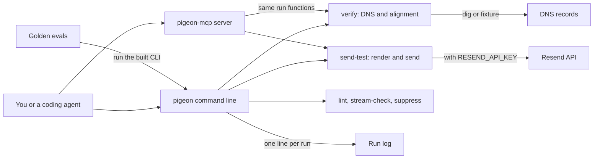

# How Pigeon works

Pigeon is a transactional email helper for developers and coding agents.
Transactional email is the mail a product sends one person because of something they did, such as a password reset.
Pigeon checks that a sending domain is set up so this mail reaches the inbox, not the spam folder.
It reads the domain's SPF, DKIM and DMARC records, the DNS entries that prove mail really comes from you, and checks that they align.
It also lints email templates, keeps marketing and transactional mail apart, and sends test mail with an idempotency key so a retry never sends twice.
Most commands run offline, with no model and no key.

## The parts



The command line is [src/cli.ts](../src/cli.ts), built to `dist/cli.js`, which registers fifteen commands from [src/commands/](../src/commands/).
Each command exposes a `run` function that returns one result shape from [src/lib/result.ts](../src/lib/result.ts) and exits non-zero on a failure or a refusal.
The MCP server in [src/mcp/server.ts](../src/mcp/server.ts) offers 12 tools over standard input and output, listed in [src/mcp/tools.ts](../src/mcp/tools.ts).
MCP, the Model Context Protocol, lets an agent call tools by name.
Its tools call the same `run` functions as the command line.

The DNS reader is [src/lib/dns.ts](../src/lib/dns.ts), and the readiness check is [src/lib/alignment.ts](../src/lib/alignment.ts).
Sending goes through the provider adapter in [src/lib/providers/resend.ts](../src/lib/providers/resend.ts), with keys made by [src/lib/idempotency.ts](../src/lib/idempotency.ts).
[src/lib/stream-policy.ts](../src/lib/stream-policy.ts) refuses to route marketing or cold mail through a transactional-only provider.
[src/lib/render-hazards.ts](../src/lib/render-hazards.ts) finds template patterns that break in common mail clients.
Each command appends a line to `logs/runs.jsonl` through [src/lib/log.ts](../src/lib/log.ts).
The evals in [eval/](../eval/) run the built command line against golden tasks.

## What happens when you run it

The main flow checks a sending domain: `pigeon verify example.com`.

1. [src/cli.ts](../src/cli.ts) parses the arguments with commander and calls `runVerify` in [src/commands/verify.ts](../src/commands/verify.ts).
2. With `--dns-fixture <file>`, it reads saved DNS records from a JSON file, so CI needs no live domain.
3. Otherwise `resolveLive` in [src/lib/dns.ts](../src/lib/dns.ts) runs `dig` for the domain's SPF record and its `_dmarc` record.
4. It also looks up DKIM keys under six common selectors, such as `resend` and `google`. A missing record counts as absent, not as an error.
5. `judgeReadiness` in [src/lib/alignment.ts](../src/lib/alignment.ts) checks that SPF, DKIM and DMARC exist and that they align with the visible From domain.
6. It also flags an SPF record that needs more than ten DNS lookups, and a DMARC policy of `p=none`. Pass `--from` to check a different From domain.
7. Pigeon prints each finding with its severity, its code and the brain note behind it, or JSON with `--json`.
8. `logRun` in [src/lib/log.ts](../src/lib/log.ts) appends the verb, the outcome and the duration to `logs/runs.jsonl`.
9. The command exits 0 only when all three records exist and align.

`pigeon send-test` is the second half of the acceptance test in [.github/workflows/acceptance.yml](../.github/workflows/acceptance.yml).
It renders the `welcome` template from [src/templates/welcome.tsx](../src/templates/welcome.tsx) and checks the stream rules first.
Without `RESEND_API_KEY` it returns a stub id built from the message, so the idempotency check still runs.

## Extending it

- **A command.** Add a module with a `run` function and a `register(program)` function in [src/commands/](../src/commands/). Register it in [src/cli.ts](../src/cli.ts).
- **An MCP tool.** Add a descriptor to `TOOL_DESCRIPTORS` and a case to `callTool` in [src/mcp/tools.ts](../src/mcp/tools.ts). Call the same `run` function.
- **A template check.** Add a hazard to [src/lib/render-hazards.ts](../src/lib/render-hazards.ts), with a reference to [brain/KNOWN-PITFALLS.md](../brain/KNOWN-PITFALLS.md). Cover it in [test/unit/lib.test.ts](../test/unit/lib.test.ts).
- **A skill.** Create `skills/<name>/SKILL.md` with `name` and `description` front matter, like [skills/pigeon-stream-separation/SKILL.md](../skills/pigeon-stream-separation/SKILL.md).
- **An eval.** Add a golden task to [eval/golden/](../eval/golden/), like [eval/golden/gt-01.json](../eval/golden/gt-01.json). Each task gives the command arguments and the output or JSON fields to expect.

Run these before you push:

```bash
pnpm install
pnpm build
pnpm test
pnpm eval
```

## Questions

**Does it need an API key or cost money?**
No key is needed for `verify`, `lint`, `stream-check`, `suppress`, the planning commands or the MCP server.
`webhook verify` needs the provider's webhook signing secret, or `--secret` for a test payload.
A live `send-test` needs `RESEND_API_KEY`, and the mail goes through your Resend account.
The optional judge, `pnpm eval:judge`, needs `ANTHROPIC_API_KEY` and is billed to that key.
The sandbox test in [sandbox/boot.mjs](../sandbox/boot.mjs) uses `E2B_API_KEY` when present, and otherwise runs the same flow locally.

**Does any data leave the machine?**
A live `verify` sends DNS queries through `dig`.
With `RESEND_API_KEY`, `send-test` sends the rendered email to the `--to` address through Resend. The default address is Resend's test inbox.
The judge sends the text from `pigeon ses-narrative` to the Anthropic API.
The cockpit in [src/cockpit/server.ts](../src/cockpit/server.ts) listens on 127.0.0.1 only.

**How does it improve itself?**
[dsip.json](../dsip.json) declares the `agent` level, with a nightly loop and no self-grading.
Today the loop is a regression gate. [.github/workflows/rsi.yml](../.github/workflows/rsi.yml) runs `pnpm eval` every day at 08:23 UTC and records the run.
[workflows/rsi.workflow.js](../workflows/rsi.workflow.js) does the same steps locally. Its model half, which would propose brain or skill patches, is not built yet.
A second job, [.github/workflows/health-check.yml](../.github/workflows/health-check.yml), runs `pigeon verify` every day at 09:17 UTC.

**How do I run its tests or evals?**
`pnpm test` runs the Vitest files in [test/](../test/).
After `pnpm build`, `pnpm eval` runs the 12 golden tasks. It fails if any task fails or the F1 score, a standard accuracy measure, is below 0.8.
`pnpm eval:judge` runs the model-judged task, and it never blocks CI.

**What does it not do?**
It does not send marketing campaigns.
`notify` sends nothing, because the Novu call is not wired yet. It says "not sent" and exits 1, unless you pass `--dry-run` to preview the channels.
`inbound setup` prints configuration and a runbook. It does not set up mail routing for you.
Only the `welcome` template ships today.
The send cache lasts one run. Across runs, the key sent to Resend is what stops a second send.
